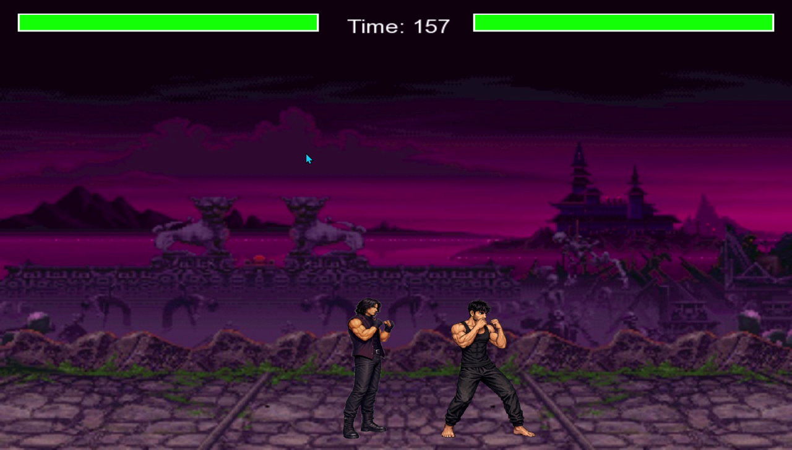

# Pixel Punch

A local two-player fighting game written in C++ with SFML. Animated fighters move, jump, and punch in an arena; hitboxes determine damage and health bars track the match.

## Demonstration



A cropped frame from the owner's existing recording, published with the owner's confirmed permission. It shows the earlier local game interface, not a fresh controller/gameplay test of this revision. [Frame provenance](docs/DEMONSTRATION.md).

## Implemented features

- Menu and instructions screens.
- Walking, idle, and punching animation states.
- Punch/hurt-box collision checks with one damage event per punch.
- 300 health points per fighter and a 180-second match timer.
- Health-based winner selection when time expires.

## Controls

| Fighter | Input |
|---|---|
| Player 1 | Controller at joystick index 0: X axis moves, negative Y axis jumps, button 0 punches |
| Player 2 | Keyboard: **A/D** move, **W** jumps, **J** punches |
| Menu | Mouse selects Start Game, Instructions, or Exit |
| During play | Escape returns to the menu |

The current source names the fighters Rayyan and Maaz. Controller button labels vary by device. Player 1 requires a connected controller; a second keyboard mapping is not implemented.

## Build and run

The original development environment used **SFML 2.6.1**. This code uses the SFML 2 API; SFML 3 is not interchangeable. Install a matching C++ toolchain, CMake, and SFML development package before configuring:

```powershell
cmake -S . -B build -DSFML_DIR="C:/path/to/SFML/lib/cmake/SFML"
cmake --build build --config Release
```

`SFML_DIR` must point to your own installation, with compiler/architecture matching the selected generator. For a Visual Studio multi-configuration build, run from the repository root:

```powershell
.\build\Release\pixel-punch.exe
```

For a single-configuration generator, the executable is directly under `build/`. Keep the working directory at the repository root so `assets/` resolves. Windows SFML DLLs must be discoverable by the executable.

## Technical notes and limitations

`Fighter` owns animation textures, movement state, collision regions, and health. The main loop handles menus, input, rendering, and match outcome. Movement/gravity currently advance per frame rather than using elapsed time, so gameplay speed can vary with hardware. The source permits movement after the match result appears; it is not a tournament rules implementation.

The font path is configurable; see [validation notes](docs/VALIDATION.md). Graphics, controller, and audio-free behavior are reported separately from compilation checks. No hosted demo is claimed.

## Attribution

Personal experimental project by Syed Muhammad Rayyan Hassan. Existing image assets are retained with their history; no new redistribution license is granted. Asset provenance should be confirmed before repackaging or distributing a release.
